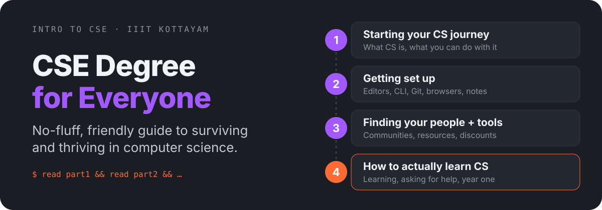

<h1 align="center">CSE Degree for Everyone</h1>

<p align="center">
  
</p>

<p align="center">
  <a href="https://intro-to-cse.vercel.app"><b>Read online</b></a> ·
  <a href="./CONTRIBUTING.md">Contribute</a> ·
  <a href="./LICENSE">MIT License</a>
</p>

Your no-fluff, friendly guide to surviving and thriving in computer science. Without needing to decode ancient scrolls or debug your soul.

Built for CS beginners who want practical, actionable advice without the academic jargon. Whether you're just starting your first semester or looking to get better organized, it covers everything from choosing code editors to finding your first tech community. Part of the Introduction to Computer Science and Engineering course at IIIT Kottayam.

## Read it

Each part builds on the previous one, but you can jump to whatever you need right now.

| Part | What's inside |
| --- | --- |
| [1. Starting Your CS Journey](./part1-starting-your-cs-journey.md) | What CS is, what you can do with it, finding your area of interest |
| [2. Getting Set Up (Without Getting Overwhelmed)](./part2-getting-set-up.md) | Code editors, command line, Git and GitHub, browsers, Markdown and notes |
| [3. Finding Your People + Long-Term Tools](./part3-finding-your-people-and-tools.md) | First CS community, tools and resources, student discounts |
| [4. How to Actually Learn CS](./part4-how-to-actually-learn-cs.md) | Learning how to learn, asking for help, surviving year one |

Bonus: [A Structured Guide to Initiating Contributions in Open Source](./part-opensource-guide.md).

## Run the website locally

The site lives in [`website/`](./website) (Astro, Tailwind, React).

```bash
cd website
npm install
npm run dev
```

## Contributing

Typos, fixes and new sections are welcome. See [CONTRIBUTING.md](./CONTRIBUTING.md) and the [Code of Conduct](./CODE_OF_CONDUCT.md).
